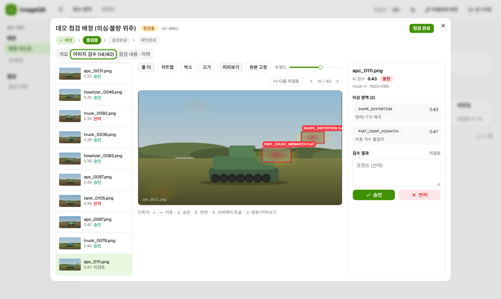
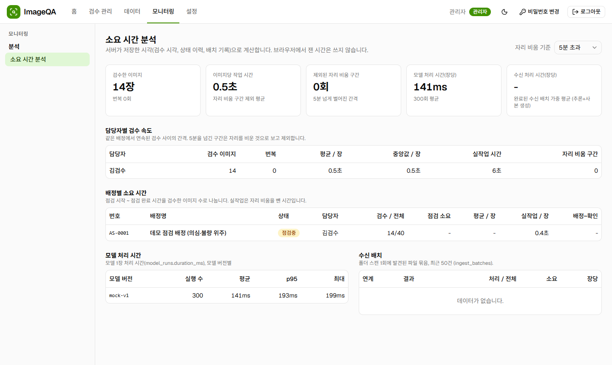

# AI 생성 이미지 QA 검수 시스템

AI가 생성한 이미지를 사전 검증한 뒤, QA 담당자가 화면에서 검수(승인/반려)하는 연습용 미니 프로젝트.
기획 전문은 [docs/plan.md](docs/plan.md), **지금까지 구현된 것과 사용 방법은 [docs/guide.md](docs/guide.md)**, 배포는 [docs/deploy.md](docs/deploy.md), 개발 진행 기록은 [docs/progress.md](docs/progress.md) 참고.

## 한눈에 보기

이미지가 들어오면 모델이 이상 영역을 찾아 점수·판정(정상/의심/불량)을 매기고, 관리자가 검수 건을 담당자에게 배정하면 담당자가 박스·히트맵을 보며 승인/반려한다. 판정 기준·권한·메뉴는 코드가 아니라 DB에서 관리하고, 소요 시간은 서버가 저장한 시각으로 분석한다.
(실제 업무 자료는 쓰지 않았다. 이미지와 데이터는 모두 직접 만든 것이다.)

| 배정 리스트 (관리자) | 이미지 검수 (QA, 박스·히트맵·단축키) |
|---|---|
|  |  |

| 소요 시간 분석 | 권한별 메뉴·기능 관리 |
|---|---|
|  |  |

다크 모드, 사용자 관리, 판정 규칙, 연계 관리, 업로드 화면은 [captures/2026-11-14_v1.0-portfolio](captures/2026-11-14_v1.0-portfolio)에 있다.

### 직접 설계·구현한 것
- **검수 흐름**: 배정 → 점검 시작 → 이미지별 승인/반려(반려는 사유 선택) → 점검 완료 → 확인 완료 (서버가 허용된 단계 이동만 통과시키고 이력을 남긴다). 3천 장 배정도 서버 페이지네이션·가상 스크롤·낙관적 업데이트로 처리.
- **검수 화면**: 이미지를 휠로 확대·드래그로 이동·원본 크기(1:1)로 크게 보면서 그 자리에서 승인/반려(`Z`), 박스에 마우스를 올리면 한글 원인·설명·점수 카드, 단축키 중심 조작. 3천 장을 다 보지 않도록 결과·AI 판정 필터와 정렬(경계에 가까운 순 등), 배정할 때 정상은 일부만 뽑는 **정상 표본**을 쓴다.
- **화면 구성**: 대시보드(할 일·판정 분포·최근 7일), 내 배정, 점검 이력(번복 기록 포함), 이미지 목록(판정·배정 여부 필터), 소요 시간 분석 등 모든 메뉴가 구현되어 있다.
- **판정 규칙 관리**: 임계값을 `rules` 테이블에 새 버전으로 쌓고, 미리보기 → 재판정 → 되돌리기. 판정마다 모델 버전과 규칙 버전을 기록한다.
- **파일 수신 파이프라인**: 폴더 감시 워커가 파일을 안정 판정·형식 확인 후 1장씩 추론하고, 실패 파일은 격리한다. 화면 업로드(수천 장, 재시도·일시 중지)도 같은 경로를 쓴다.
- **사용자·권한·메뉴**: 가입 승인, 사용기한·만료 해제, 일괄 처리, 권한 종류와 권한별 메뉴·기능을 DB로 관리하고 서버가 같은 표로 API를 막는다. 로그인 시도 횟수 제한, 임시 비밀번호 발급과 변경 강제.
- **모델 어댑터**: 호출부를 어댑터로 분리하고 출력 JSON 계약을 고정했다. 기본은 목(mock) 모델, 실제 모델(PatchCore, Anomalib)도 같은 계약으로 연결해 정답 데이터로 평가한다(이 데이터에서는 AUROC 0.683 — 연결 검증용 기준선이며 한계와 개선 후보는 [design.md](docs/design.md) 9장에 정리).
- **테스트**: 백엔드 254개(API 통합·마이그레이션·워커 등, 전용 DB), 프론트 단위 79개, 브라우저 시나리오 12개(Playwright), 파이썬 17개.

기술: React · Vite · TypeScript · Tailwind · shadcn/ui / Node.js(Fastify) · PostgreSQL / Python(PatchCore) / Docker.

### 바로 실행해 보기 (Docker만 있으면 됨)
```
cp .env.example .env      # 비밀번호·JWT_SECRET 수정
docker compose --profile app up -d --build   # http://localhost:8080
```
데모 계정 `admin@example.com`(관리자), `qa1@example.com`(QA) / 비밀번호 `1234`. 데모 이미지 300장과 `qa1`의 데모 배정 1건이 자동으로 만들어진다. 이 `1234`는 **로컬 데모 전용**이다: 공개 서버는 `DEMO_MODE=false`와 `ADMIN_PASSWORD`를 설정해야 시작되고 데모 계정은 시작할 때 정리된다([docs/deploy.md](docs/deploy.md)).

## 구조
```
frontend/   React + Vite + TypeScript + Tailwind + shadcn/ui (백엔드 API에 연결)
backend/    Node.js(Fastify) API + 파일 수신 워커, PostgreSQL
python/     실제 모델(PatchCore) 학습·추론 서버·평가 도구
db/init/    스키마·시드 SQL (컨테이너 최초 기동 시 자동 실행)
db/migrations/  이후 변경 SQL (번호순, `npm run migrate`로 적용, 적용 이력은 schema_migrations)
docs/       기획서(plan.md), 설계 결정과 이유(design.md), 진행 기록(progress.md), 사용 방법(guide.md), 배포 방법(deploy.md), 개념 정리(study-notes.md)
Dockerfile  화면+API를 한 이미지로 묶는 배포 구성 (docker-compose.yml의 `app` 프로필)
docker-compose.prod.yml, deploy/  운영(VPS) 구성: HTTPS 프록시(Caddy)와 공개용 설정 고정 (docs/deploy.md 6장)
```

## 전체 실행 (개발)
```
docker compose up -d                          # DB
cd backend && npm install && npm run migrate     # 스키마 변경분 적용 (이미 적용된 것은 건너뜀)
npm run load-mock                             # 최초 1회: 목 데이터 생성(generate-mock) 후 적재
npm run dev                                   # API, 포트 3000 (.env의 JWT_SECRET 필요)
npm run worker                                # (선택) 파일 수신 워커: inbox에 이미지를 넣거나 화면에서 업로드하면 5초 주기로 수신·추론 (실제 모델: python/README.md)
cd ../frontend && npm run dev                 # 화면, 포트 5173 (/api는 API_PORT(기본 3000)로 프록시)
# 윈도우가 3000을 예약해 EACCES가 나면: API_PORT=3101 을 앞에 붙여 backend/frontend를 모두 실행
```
처음이면 `npm run generate-mock`을 먼저 실행해 `data/images/`를 만든다.
엔드포인트 요약은 [docs/design.md](docs/design.md) 3-1장. DB를 완전히 새로 시작하려면 `docker compose down -v` 후 다시 `up -d`(데이터 삭제).

## 테스트
```
cd backend && npm test      # 백엔드 테스트 254개 (API 통합, 사용자·권한·메뉴, 업로드, 수신·워커, 마이그레이션, 모델 계약·어댑터) (DB 컨테이너 필요, 전용 DB qa_review_test를 매번 새로 만든다)
cd frontend && npm test     # 단위 테스트 79개 (영문 코드↔한글 매핑, 페이징, 사용자·권한 문구, 업로드 전송 큐, 반려 사유 등)
cd frontend && npx tsc -b   # 타입 체크
cd python && .venv/Scripts/python -m unittest test_metrics test_postprocess   # 파이썬 단위 테스트 17개 (모델 없이 실행)
cd frontend && npm run test:e2e   # 화면(브라우저) 자동 테스트 12개 (Playwright + 설치된 크롬, DB 컨테이너 필요)
```
개발 DB(`qa_review`)는 테스트가 건드리지 않는다. 화면 테스트는 전용 DB `qa_review_test`와 API 3201·프론트 5273 포트를 스스로 띄웠다 끈다(`backend/test/e2e-server.mjs`, `frontend/playwright.config.ts`).

## 결정 사항
- 저장소는 프론트/백엔드를 함께 두는 모노레포
- DB는 PostgreSQL (직접 운영, Docker)
- 검수 결과(`reviews`)는 별도 테이블, 쌓기만 하는 기록. 소요 시간은 서버가 저장한 시각(`decided_at`, 상태 이력)으로 계산
- 강조색은 진한 연두색
- 회사 데이터는 절대 사용하지 않음
- DB의 상태/판정 값은 영문 코드로 저장 (ASSIGNED/IN_REVIEW/REVIEWED/CONFIRMED, NORMAL/SUSPECT/DEFECT, APPROVED/REJECTED), 한글 표기는 화면에서 매핑
- `assignment_images`는 소속(+배정 시점의 AI 결과 run_id)만, 검수 결과는 `reviews`에 쌓고 최신 행이 현재 상태 (뷰 `review_current`)
- 수신 배치 기록은 `ingest_batches`, 상태 변경은 `assignment_history`에 남겨 소요 시간 분석에 사용 (`batch_jobs`는 폐기된 사전배치의 과거 기록 보존용)
