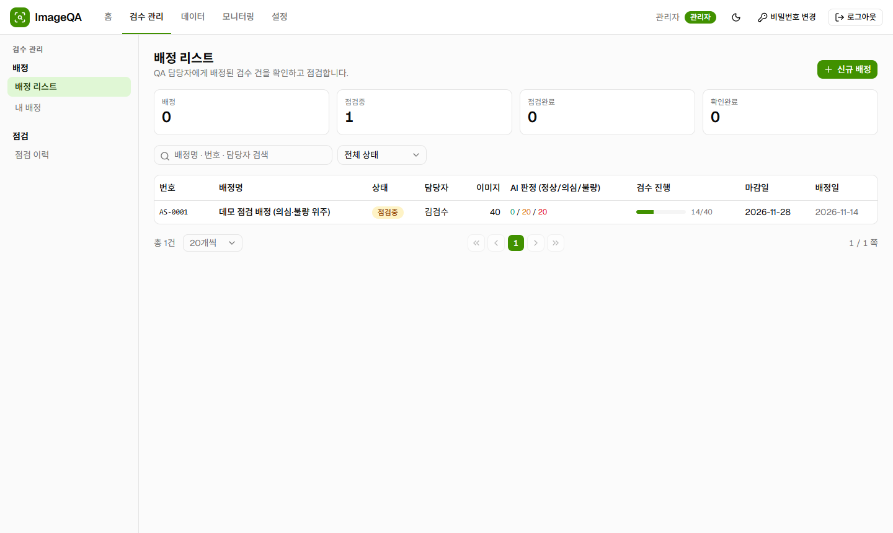
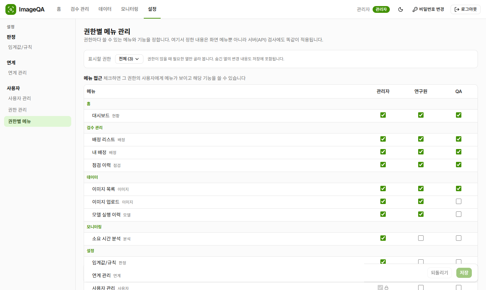

# AI 생성 이미지 QA 검수 시스템

AI가 생성한 이미지를 사전 검증한 뒤, QA 담당자가 화면에서 검수(승인/반려)하는 연습용 미니 프로젝트.
기획 전문은 [docs/plan.md](docs/plan.md), **지금까지 구현된 것과 사용 방법은 [docs/guide.md](docs/guide.md)** 참고.

## 한눈에 보기

이미지가 들어오면 모델이 이상 영역을 찾아 점수·판정(정상/의심/불량)을 매기고, 관리자가 검수 건을 담당자에게 배정하면 담당자가 박스·히트맵을 보며 승인/반려한다. 판정 기준·권한·메뉴는 코드가 아니라 DB에서 관리하고, 소요 시간은 서버가 저장한 시각으로 분석한다.
(실제 업무 자료는 쓰지 않았다. 이미지와 데이터는 모두 직접 만든 것이다.)

| 배정 리스트 (관리자) | 이미지 검수 (QA, 박스·히트맵·단축키) |
|---|---|
|  |  |

| 소요 시간 분석 | 권한별 메뉴·기능 관리 |
|---|---|
|  |  |

다크 모드, 사용자 관리, 판정 규칙, 연계 관리, 업로드 화면은 [captures/2026-11-14_v1.0-portfolio](captures/2026-11-14_v1.0-portfolio)에 있다.

### 직접 설계·구현한 것
- **검수 흐름**: 배정 → 점검 시작 → 이미지별 승인/반려 → 점검 완료 → 확인 완료 (서버가 허용된 단계 이동만 통과시키고 이력을 남긴다). 3천 장 배정도 서버 페이지네이션·가상 스크롤·낙관적 업데이트로 처리.
- **판정 규칙 관리**: 임계값을 `rules` 테이블에 새 버전으로 쌓고, 미리보기 → 재판정 → 되돌리기. 판정마다 모델 버전과 규칙 버전을 기록한다.
- **파일 수신 파이프라인**: 폴더 감시 워커가 파일을 안정 판정·형식 확인 후 1장씩 추론하고, 실패 파일은 격리한다. 화면 업로드(수천 장, 재시도·일시 중지)도 같은 경로를 쓴다.
- **사용자·권한·메뉴**: 가입 승인, 사용기한·만료 해제, 일괄 처리, 권한 종류와 권한별 메뉴·기능을 DB로 관리하고 서버가 같은 표로 API를 막는다. 로그인 시도 횟수 제한, 임시 비밀번호 발급과 변경 강제.
- **모델 어댑터**: 호출부를 어댑터로 분리하고 출력 JSON 계약을 고정했다. 기본은 목(mock) 모델, 실제 모델(PatchCore, Anomalib)도 같은 계약으로 연결해 정답 데이터로 평가한다(이 데이터에서는 AUROC 0.683 — 연결 검증용 기준선이며 한계와 개선 후보는 [design.md](docs/design.md) 9장에 정리).
- **테스트**: 백엔드 232개(API 통합·마이그레이션·워커 등, 전용 DB), 프론트 단위 52개, 브라우저 시나리오 7개(Playwright), 파이썬 17개.

기술: React · Vite · TypeScript · Tailwind · shadcn/ui / Node.js(Fastify) · PostgreSQL / Python(PatchCore) / Docker.

### 바로 실행해 보기 (Docker만 있으면 됨)
```
cp .env.example .env      # 비밀번호·JWT_SECRET 수정
docker compose --profile app up -d --build   # http://localhost:8080
```
데모 계정 `admin@example.com`(관리자), `qa1@example.com`(QA) / 비밀번호 `1234`. 데모 이미지 300장과 `qa1`의 데모 배정 1건이 자동으로 만들어진다. 이 `1234`는 **로컬 데모 전용**이다: 공개 서버는 `DEMO_MODE=false`와 `ADMIN_PASSWORD`를 설정해야 시작되고 데모 계정은 시작할 때 정리된다([docs/deploy.md](docs/deploy.md)).

## 구조
```
frontend/   React + Vite + TypeScript + Tailwind + shadcn/ui (백엔드 API에 연결)
backend/    Node.js(Fastify) API + 파일 수신 워커, PostgreSQL
python/     실제 모델(PatchCore) 학습·추론 서버·평가 도구
db/init/    스키마·시드 SQL (컨테이너 최초 기동 시 자동 실행)
db/migrations/  이후 변경 SQL (번호순, `npm run migrate`로 적용, 적용 이력은 schema_migrations)
docs/       기획서(plan.md), 설계·진행 기록(design.md), 사용 방법(guide.md), 배포 방법(deploy.md), 개념 정리(study-notes.md)
Dockerfile  화면+API를 한 이미지로 묶는 배포 구성 (docker-compose.yml의 `app` 프로필)
```

## 실행 (프론트엔드, 개발)
```
cd frontend
npm install
npm run dev
```
데모 계정: `admin@example.com`(관리자), `qa1@example.com`(QA) / 비밀번호 `1234`

## 다음에 이어서 할 일 (여기서부터 재개)
**지금 진행 중인 큰 작업: 파일 수신 시 사전 검증.** 결정과 이유는 [docs/design.md](docs/design.md) 8장, 개념 설명은 [docs/study-notes.md](docs/study-notes.md).
요약: 폴더 감시(inbox → processing → done/failed, 파일 이동) → 별도 워커가 1장씩 순차 추론 → 판정. 사전배치(PRECHECKED) 상태는 없앴다(⑥ 완료). 같은 파일 재수신은 막지 않고 새 행으로 쌓되 `origin_image_id`로 연결.

구현 순서 (각 단계마다 테스트 통과 후 커밋, 결정과 이유는 design.md 9장):
1. [x] DB 마이그레이션 + 모델 어댑터 계약/목 구현 (3ef6f0d)
2. [x] `scanOnce`/`processOne`/`runCycle` + 워커 (`npm run worker`) (c6d3efc)
3. [x] ① 워커 단일 실행 잠금 + 시작 시 고아 파일·PROCESSING 정리
4. [x] ② 이미지 ID 기반 파일 API (`/api/images/:key/thumb|preview|original|heatmap`), 이미지 단위 권한, 보안/캐시 헤더. 기존 `/files` 제거
5. [x] ③ ComfyUI로 실제 원본 이미지 생성 스크립트 (300~500장, 정답 박스 포함). ComfyUI는 `H:\jjal\ComfyUI\ComfyUI_windows_portable` (`run_comfyui.bat`, 포트 8188), 모델은 `ComfyUI\models`
6. [x] ④ 썸네일·미리보기(webp) 생성 (비율 유지) — 추론 후 `thumb_path`/`preview_path` 채움. 이미 수신된 이미지는 `npm run make-derivatives`
7. [x] ⑤ 검수 화면: 보기 모드 토글(미리보기/원본 고정, 이웃 미리 받기) + 마지막 검수자·시각 표시 (`reviewerName`/`reviewedAt`은 API에 이미 있음)
8. [x] ⑥ PRECHECKED 제거 (마이그레이션 002, 백엔드 `TRANSITIONS`·신규 배정 `ingest_status='DONE'` 조건, 프론트 4단계, 소요 시간 화면의 사전배치 → 수신 배치, 테스트)
9. [x] ⑦ 관리자 `연계 관리` 화면 (설정 > 연계 > 연계 관리): 연계 목록·요약 건수, 추가·수정·켜기/끄기, 변경 이력, 실패 건 재시도. 마이그레이션 003, `/api/integrations`, `ingest/retry.mjs`

확정된 선택(2026-11-02): 공통 컬럼은 기존 테이블에도 소급(쌓기 전용 제외), 재수신 행은 신규 배정에서 함께 담기 허용(화면에 "재수신" 표시), 마이그레이션은 SQL 파일 순서 적용, 원본 열람 기록은 불필요.

10. [x] 규칙 관리 (`/api/rules`: 새 버전 쌓기, 미리보기, 재판정, 되돌리기, 이력. 마이그레이션 004) + 화면(설정 > 판정 > 임계값/규칙)

- 공통 규칙(목록 페이징): 기본 20건, 목록 하단 좌측 콤보박스로 20/50/100/1000 선택, 가운데 번호(10개 묶음) 이동 (`components/common/Pagination.tsx`, `lib/paging.ts`, 서버 상한 `backend/src/paging.mjs`). 새 목록 화면은 모두 이것을 쓴다.
11. [x] 사용자 관리 1단계: 계정 상태(승인 대기/사용 중/만료/비활성)·사용기한·신청 권한. 가입은 승인 신청, 로그인 시 상태별 안내와 기한 +1년 갱신, 토큰도 매 요청 상태 확인. 마이그레이션 005 (화면 없음)
12. [x] 사용자 관리 2단계 API: `/api/admin/users` (목록·필터·건수, 수정, 일괄 처리 `bulk`: 승인/반려/비활성/재활성/만료 해제, 임시 비밀번호), 가입 시 프로필, 만료 해제 요청 `/api/auth/expiry-release-request`, 사용자 이력. 마이그레이션 006 
13. [x] 사용자 관리 화면 (설정 > 사용자 > 사용자 관리): 상태 필터(건수)·권한·검색, 상태별 열, 선택 후 일괄 승인/반려/비활성/재활성/만료 해제(전체 선택 시 100명씩 자동 분할), 수정 모달(권한·사용기한·소속·연락처·임시 비밀번호·이력). 가입 화면에 소속·연락처, 로그인 화면에 만료 해제 요청
14. [x] 사용자 관리 3단계 API: 권한(roles)·권한 코드(permissions)·메뉴(menus)·권한별 부여(role_permissions)를 DB로. 서버의 모든 권한 검사가 `isAdmin()` 대신 권한 코드(`can()`, `requirePermission`)로 바뀜. `/api/menus/mine`, `/api/admin/permissions`(조회·`PUT /admin/roles/:code/permissions`·이력), `/auth/me`에 권한 코드. 마이그레이션 007 
15. [x] 사용자 관리 3단계 화면: 설정 > 사용자 > 권한별 메뉴(권한 × 메뉴·기능 체크 표, 변경 요약·저장·되돌리기·이력). 화면 메뉴를 `/api/menus/mine`에서 받아 그리고, 화면의 `role === 'admin'` 비교를 권한 코드(`useCan`)로 교체, 권한 없는 경로는 '권한 없음' 안내

16. [x] 권한 종류 DB 전환: 고정 목록(`ROLES`·`ROLE_LABEL`) 제거, `GET /roles`·`/auth/signup-roles`, `roles.signup_selectable`(마이그레이션 008), 권한별 메뉴 표에 권한 다중 선택 필터·가로 스크롤(첫 열 고정), 접근 불가 안내

17. [x] 권한 관리: `/api/admin/roles`(만들기·수정·설명·사용 안 함/다시 사용·삭제, 이력; 마이그레이션 009), 삭제 대신 「사용 안 함」이 기본(cascade 없음, 사용자·이력 없을 때만 삭제), 화면(설정 > 사용자 > 권한 관리: 목록·통합 모달)과 권한별 메뉴 표 열 머리의 설명 툴팁

18. [x] 사유 코드 `UNKNOWN`(원인 미분류) 추가(마이그레이션 010). 실제 모델 어댑터(PatchCore, Anomalib): `MODEL_ADAPTER=patchcore`, Python 추론 서버 `python/serve.py` + 학습 `python/train.py`(사용법 `python/README.md`), 점수 0~1 변환·이상 맵 → 원본 픽셀 박스·투명 히트맵 PNG

19. [x] 신규 배정 담당자 후보를 기능 권한 `assignment.receive`(배정받기)로: `GET /api/assignees`, 배정 생성 시 서버 검증(마이그레이션 011), 권한별 메뉴 표에서 켜고 끔

20. [x] 이미지 업로드: API(`/api/uploads`, 마이그레이션 012; 배치·파일 기록, 수신 폴더 반입, 처리 현황 추적, 수천 장 대응) + 화면(데이터 > 이미지 > 이미지 업로드: 파일·폴더 끌어놓기/선택, 4장씩 동시 전송·재시도·일시 중지·취소, 업로드 이력과 파일별 처리 현황)

21. [x] 모델 평가 도구(`python/evaluate.py`, `metrics.py`): 정답 데이터로 이미지 AUROC·컷오프별 잡는 비율/오탐·박스 적중·결함 종류별·속도. 첫 결과(PatchCore): AUROC 0.683, 비율 이상(SCALE) 0.906은 잘 잡고 부품 개수(PART_COUNT) 0.563은 거의 무작위 — 연결 검증용 기준선이며 개선 후보는 design.md 9장 마지막
22. [x] 비밀값 교체 스크립트(`npm run rotate-secrets`: .env의 DB 비밀번호·JWT_SECRET을 새 값으로, 값은 출력하지 않음), 실행·초기화·교체 절차 문서화(guide 4장)

23. [x] 로그인 시도 횟수 제한: 이메일당 15분에 5번 / 주소당 30번 실패하면 15분 잠금(429 `LOCKED`), 없는 이메일도 똑같이 처리, 성공하면 초기화, 만료 해제 요청과 횟수 공유. 마이그레이션 013, `src/loginGuard.mjs`

24. [x] 임시 비밀번호 메일 발송 + 비밀번호 변경 강제: 백엔드(마이그레이션 014, `src/mail.mjs`, `POST /auth/change-password`, `MAIL_MODE`)와 화면. 임시 비밀번호로 로그인하면 변경 화면만 보이고(서버도 다른 API를 403으로 막음) 바꾸면 원래 화면으로 간다. 상단 `비밀번호 변경`으로 본인이 언제든 변경 가능, 사용자 수정 모달은 메일 발송 시 "메일로 발송했습니다"(관리자는 비밀번호를 못 봄)를 보여 준다. Playwright 시나리오 추가.

25. [x] 배포 준비: `Dockerfile`(화면 빌드+API 한 이미지), `docker-compose.yml`의 `app`·`worker`(프로필 `app`), 시작 시 마이그레이션·데모 데이터 자동 준비(`backend/scripts/docker-start.mjs`), API 서버의 화면 서빙(`FRONTEND_DIST`), `HOST`·`TRUST_PROXY`·`COOKIE_SECURE` 설정, `LICENSE`(MIT), [docs/deploy.md](docs/deploy.md). 전체 스택을 격리 환경에서 띄워 로그인·파일 API·워커까지 확인.

26. [x] 공개용 데모 정리: `DEMO_MODE`(기본: 운영 모드가 아니면 켬, compose는 켬). 켜면 로그인 화면에 데모 계정 안내·기본 입력값을 보이고 시작 시 데모 배정 1건(qa1, 의심·불량 40장)을 만든다. 끄면(공개 서버) 빈 칸으로 시작하고 안내·배정 없음. 화면은 로그인 전 `GET /api/config`로 읽는다. 두 모드를 Docker로 확인.

28. [x] 공개 서버의 초기 비밀번호: `DEMO_MODE=false`면 시작할 때 비밀번호가 아직 `1234`인 계정을 찾아 관리자는 `.env`의 `ADMIN_PASSWORD`(12자 이상)로 교체하고 나머지 데모 계정은 비활성화+무작위 비밀번호로 만든다. 설정이 없거나 약하면 서버가 시작을 거부한다. 다시 시작해도 덮어쓰지 않는다. 로컬 데모(`DEMO_MODE=true`)는 `1234` 그대로. `src/bootstrap.mjs`, `npm run bootstrap-admin`. 컨테이너로 거부·적용·재시작을 확인.

29. [x] 핵심 흐름 E2E(Playwright `e2e/review-flow.spec.ts`): 관리자 배정 → QA 점검 시작 → 승인/반려 → 점검 완료 → 관리자 확인 완료.

27. [x] 포트폴리오용 화면 캡처(`captures/2026-11-14_v1.0-portfolio`, 11장: 로그인·배정·검수(라이트/다크)·신규 배정·소요 시간·규칙·사용자·권한별 메뉴·연계·업로드)와 README 맨 위 소개

남은 후보(필요할 때): GitHub 푸시, 공개 서버 실제 배포, 모델 개선·다른 모델 비교(평가 도구 있음), 다국어(design.md 6장).

### 점검 메모 (2026-11-04)
전체 점검 결과(2026-11-04 시점, 현재 개수는 아래 테스트 절): 백엔드 테스트 208개·프론트 50개·파이썬 17개 모두 통과, `tsc -b`·`vite build` 성공. 정리할 작은 항목:
- 프론트 린트(`npm run lint`, oxlint): 경고 0 (2026-11-05 정리, 바뀐 5곳은 Playwright 화면 테스트로 확인). 모달·폼을 불러온 값으로 채우던 `useEffect`+`setState`를 "렌더 중에 키가 바뀐 때만 한 번 채우기"로 바꿨고(UserEditDialog, RoleEditDialog, IntegrationFormDialog, RulesPage, MenusPage), shadcn 생성 폴더 `components/ui`는 `only-export-components` 규칙을 껐다. 브라우저 동작 확인은 아직 안 함.
- 번들 분할 완료(2026-11-05): 화면 본문 9개를 `React.lazy`로 나눠 첫 번들이 770KB → 373KB(gzip 241 → 118KB). 본문을 받는 동안에는 상단·좌측 메뉴를 유지하고 본문만 '불러오는 중…'. 이 점검 항목은 모두 정리됨.
- 화면 자동 테스트(Playwright)는 폼 5곳 + 임시 비밀번호→변경 강제 + 배정~확인 완료 핵심 흐름 1개 (2026-11-14).
- (2026-11-14) `npm test`(vitest)가 `e2e/` 폴더를 읽어 실패하던 문제를 `vite.config.ts`의 `test.exclude`로 고쳤다.

새 세션 시작: `README.md 읽고 이어서 해줘` 한 줄이면 된다 (CLAUDE.md가 README → design.md 순서로 읽도록 안내함).

자세한 설계와 이유는 [docs/design.md](docs/design.md) 참고.

## 진행 현황
- [x] 프론트엔드 목업: 로그인/회원가입, 레이아웃(상단·좌측·우측), 배정 리스트, 신규 배정 모달, 배정 상세(이미지 검수·이력)
- [x] DB 스키마 + `docker-compose.yml` (Postgres 16, 최초 11개 테이블 + 뷰 2개로 시작, 마이그레이션 014까지 적용 후 28개 테이블(`schema_migrations` 포함) + 뷰 2개)
- [x] JSON → DB 적재 스크립트: `cd backend && npm install && npm run load-mock` (3천 장 적재 검증, 재실행해도 중복 없음)
- [x] 목 이미지/모델 결과 생성 스크립트: `node backend/scripts/generate-mock.mjs --count 3000` → `data/images/`(git 제외), `results.jsonl`은 5장 JSON 계약 + originalPath/durationMs
- [x] 백엔드 API (Fastify): 인증, 배정 목록/상세/신규/상태 변경/점검 내용, 이미지 페이지 조회, 검수 저장, 파일 서빙 (`cd backend && npm run dev`, 포트 3000)
- [x] 규칙 관리 API(새 버전 쌓기·미리보기·재판정·되돌리기), 썸네일 생성 (화면 포함)
- [x] 프론트를 실제 API로 교체, 3천 장 대응 (서버 페이지네이션 + 가상 스크롤 + 낙관적 업데이트). 3천 장 배정 생성→점검→검수 흐름을 브라우저로 확인 (당시에는 사전배치 단계가 있었고 이후 ⑥에서 제거) (`captures/2026-11-02_v0.2-api-connected`)
- [x] 모니터링 페이지(소요 시간 분석): 담당자별 검수 속도, 배정별 소요, 모델 처리 시간, 수신 배치 기록 (`/monitoring/time`, 관리자 전용)
- [x] 파일 수신 사전 검증 1단계: 마이그레이션 체계(`npm run migrate`), 수신 상태 컬럼, 연계/수신 배치 테이블, 모델 어댑터 계약 검증 + 목 어댑터
- [x] 파일 수신 사전 검증 2단계: 폴더 스캔(안정 판정, 매직바이트, 해시 연결), 순차 추론, 실패 격리, 워커 (`npm run worker`)
- [x] 워커 단일 실행 잠금(advisory lock), 시작 시 고아 파일·PROCESSING 정리
- [x] 파일 수신 사전 검증 후속 (위 구현 순서 4~9: 파일 API, 실제 이미지 생성, 썸네일, 검수 화면 보기 모드, PRECHECKED 제거, 연계 관리)
- [x] 실제 모델 연동 (PatchCore 어댑터 + Python 추론 서버, 평가 도구로 기준선 측정)
- [x] 사용자·권한·메뉴 관리, 규칙 관리, 이미지 업로드, 비밀값 교체 (위 구현 순서 10~22)

## 전체 실행 (개발)
```
docker compose up -d                          # DB
cd backend && npm install && npm run migrate     # 스키마 변경분 적용 (이미 적용된 것은 건너뜀)
npm run load-mock                             # 최초 1회: 목 데이터 생성(generate-mock) 후 적재
npm run dev                                   # API, 포트 3000 (.env의 JWT_SECRET 필요)
npm run worker                                # (선택) 파일 수신 워커: inbox에 이미지를 넣거나 화면에서 업로드하면 5초 주기로 수신·추론 (실제 모델: python/README.md)
cd ../frontend && npm run dev                 # 화면, 포트 5173 (/api는 API_PORT(기본 3000)로 프록시)
# 윈도우가 3000을 예약해 EACCES가 나면: API_PORT=3101 을 앞에 붙여 backend/frontend를 모두 실행
```
처음이면 `npm run generate-mock`을 먼저 실행해 `data/images/`를 만든다.
엔드포인트 요약은 [docs/design.md](docs/design.md) 3-1장.

## 테스트
```
cd backend && npm test      # 백엔드 테스트 232개 (API 통합, 사용자·권한·메뉴, 업로드, 수신·워커, 마이그레이션, 모델 계약·어댑터) (DB 컨테이너 필요, 전용 DB qa_review_test를 매번 새로 만든다)
cd frontend && npm test     # 단위 테스트 52개 (영문 코드↔한글 매핑, 페이징, 사용자·권한 문구, 업로드 전송 큐 등)
cd frontend && npx tsc -b   # 타입 체크
cd python && .venv/Scripts/python -m unittest test_metrics test_postprocess   # 파이썬 단위 테스트 17개 (모델 없이 실행)
cd frontend && npm run test:e2e   # 화면(브라우저) 자동 테스트 7개 (Playwright + 설치된 크롬, DB 컨테이너 필요)
```
개발 DB(`qa_review`)는 테스트가 건드리지 않는다. 화면 테스트는 전용 DB `qa_review_test`와 API 3201·프론트 5273 포트를 스스로 띄웠다 끈다(`backend/test/e2e-server.mjs`, `frontend/playwright.config.ts`).

## DB 실행
```
cp .env.example .env     # 비밀번호 수정
docker compose up -d      # 최초 기동 시 db/init/*.sql 자동 적용
docker compose down -v    # 스키마를 바꿔 다시 적용할 때 (데이터 삭제)
```

## 결정 사항
- 저장소는 프론트/백엔드를 함께 두는 모노레포
- DB는 PostgreSQL (직접 운영, Docker)
- 검수 결과(`reviews`)는 별도 테이블, 쌓기만 하는 기록. 소요 시간은 서버가 저장한 시각(`decided_at`, 상태 이력)으로 계산
- 강조색은 진한 연두색
- 회사 데이터는 절대 사용하지 않음
- DB의 상태/판정 값은 영문 코드로 저장 (ASSIGNED/IN_REVIEW/REVIEWED/CONFIRMED, NORMAL/SUSPECT/DEFECT, APPROVED/REJECTED), 한글 표기는 화면에서 매핑
- `assignment_images`는 소속(+배정 시점의 AI 결과 run_id)만, 검수 결과는 `reviews`에 쌓고 최신 행이 현재 상태 (뷰 `review_current`)
- 수신 배치 기록은 `ingest_batches`, 상태 변경은 `assignment_history`에 남겨 소요 시간 분석에 사용 (`batch_jobs`는 폐기된 사전배치의 과거 기록 보존용)
